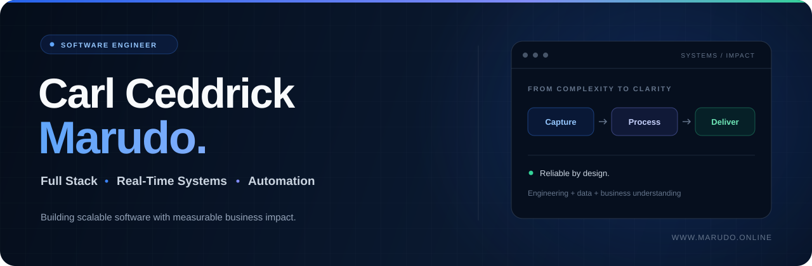
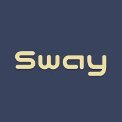
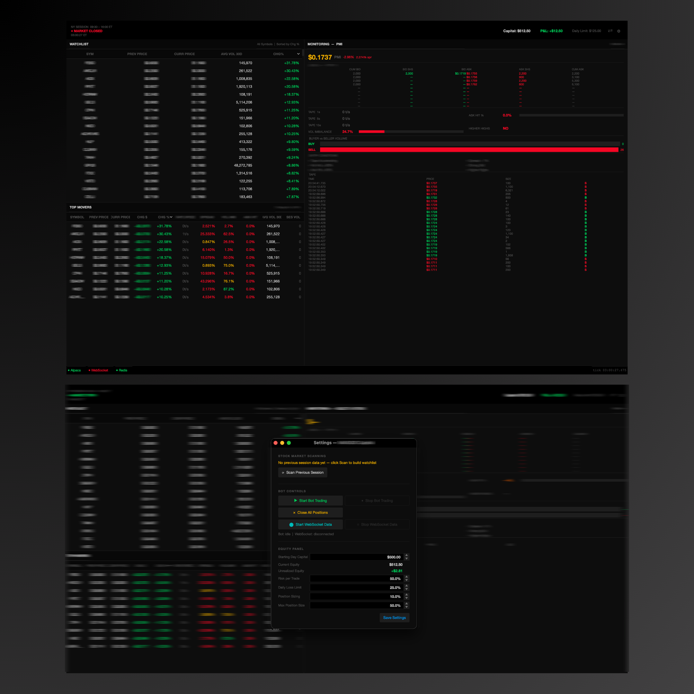
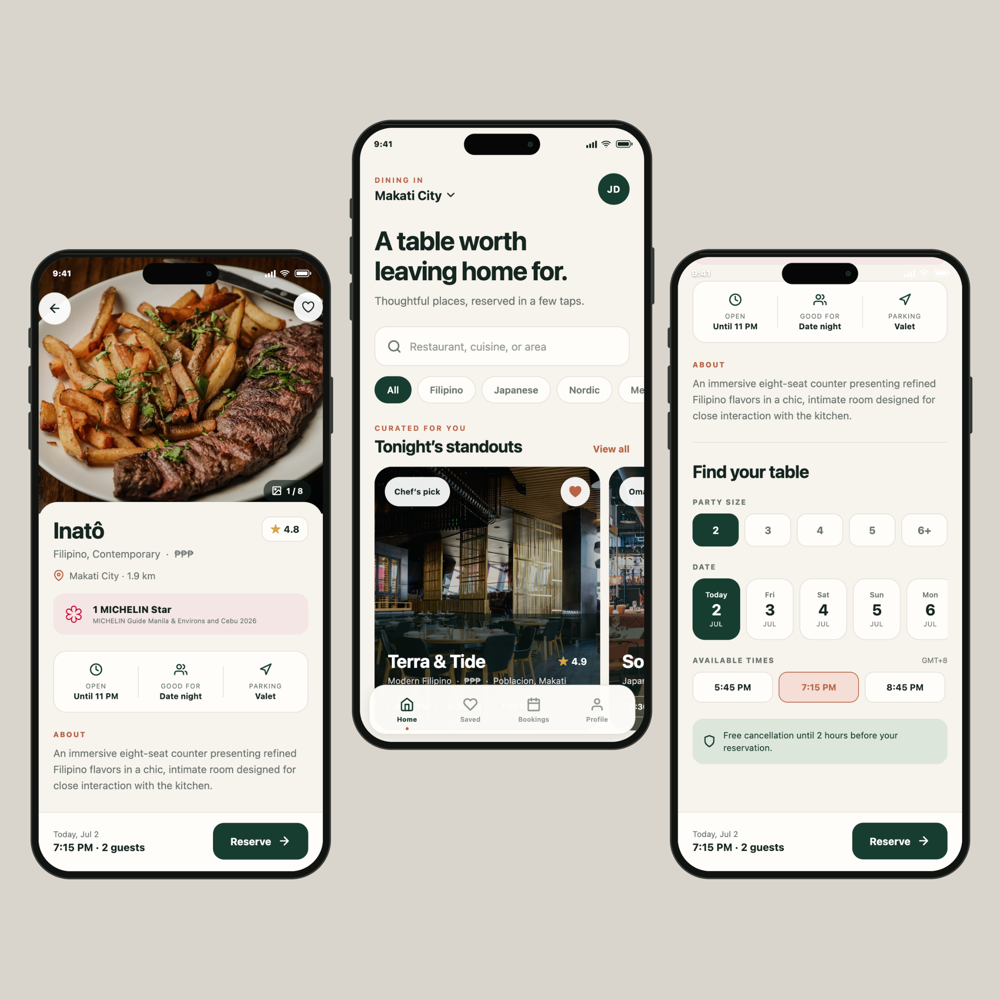
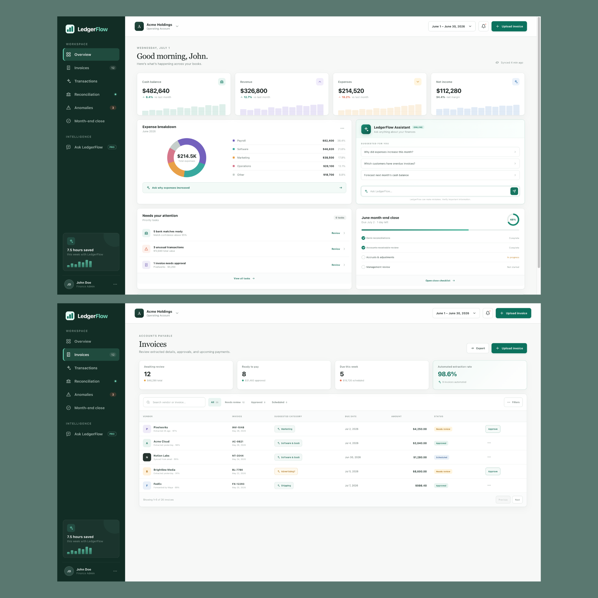
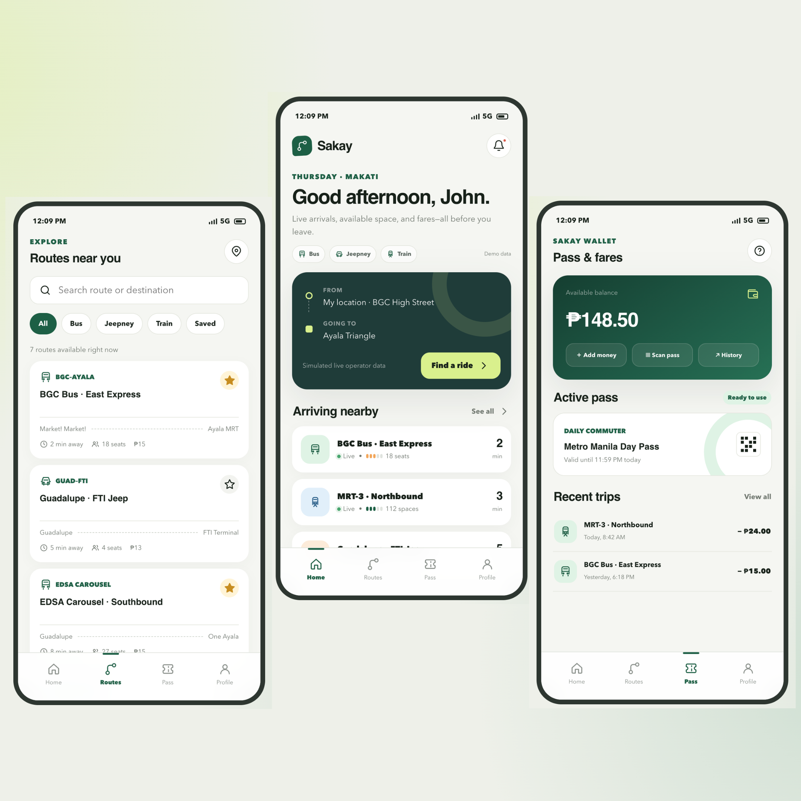
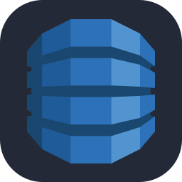
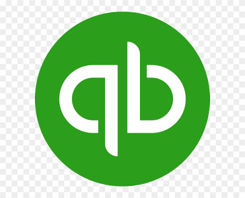
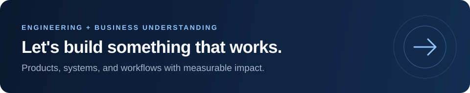

  

  <a href="https://www.marudo.online/"><strong>Portfolio ↗</strong></a>
  &nbsp;&nbsp; · &nbsp;&nbsp;
  <a href="https://www.linkedin.com/in/carlceddrickmarudo/"><strong>LinkedIn ↗</strong></a>
  &nbsp;&nbsp; · &nbsp;&nbsp;
  <a href="mailto:carlceddrick@marudo.online"><strong>Email Me ↗</strong></a>

 

<h3 align="center">Scalable systems. Reliable software. Measurable business impact.</h3>

I’m <strong>Carl Ceddrick Marudo</strong>, a software engineer working across full stack development, distributed systems, cloud infrastructure, and automation. I build software that improves performance, reliability, and the way businesses operate.

Currently a <strong>Software Engineer at Amazon</strong>, building event-driven services and API-triggered workflows. My background also spans accounting, analytics, and financial research, so I approach engineering with an understanding of the business behind the product.

 

<table width="100%" aria-label="Engineering focus">
  <tr>
    <td width="320" align="center" valign="top">
       
      
      <h3>Full Stack</h3>
      
Web · mobile · desktop

       
    </td>
    <td width="320" align="center" valign="top">
       
      
      <h3>Real-Time Systems</h3>
      
Data · APIs · events

       
    </td>
    <td width="320" align="center" valign="top">
       
      
      <h3>Automation</h3>
      
Finance · operations

       
    </td>
  </tr>
</table>

 

<table width="100%">
  <tr>
    <td width="480" align="center"> <h3>3+</h3><strong>Years of engineering experience</strong>  </td>
    <td width="480" align="center"> <h3>50K+</h3><strong>Daily jobs processed</strong>  </td>
  </tr>
  <tr>
    <td width="480" align="center"> <h3>~35%</h3><strong>Faster API response times</strong>  </td>
    <td width="480" align="center"> <h3>100+</h3><strong>Hours saved monthly through automation</strong>  </td>
  </tr>
</table>

 

## Work Experience

<table width="100%">
  <tr><td>
     
    <figure aria-label="Amazon work experience">
    <h3> &nbsp; Amazon</h3>

<strong>Software Engineer</strong> May 2026 – Present San Francisco, California, United States

 

<ul>
  <li>
Implemented event-driven backend services using Java/Python, AWS Lambda, SQS, and DynamoDB, handling <strong>50K+ daily jobs and API-triggered workflows</strong> with retry, idempotency, and failure-recovery controls.
</li>
  <li>
Reduced <strong>API response times by ~35% across 8+ production endpoints</strong> by profiling service bottlenecks, optimizing database queries, introducing caching, and removing redundant downstream calls.
</li>
  <li>
Deployed and hardened software across <strong>3+ enterprise environments</strong>, building custom API integrations, data-mapping logic, workflow automation, CloudWatch monitoring, dead-letter queues, and CI/CD safeguards that cut recurring operational failures by ~30%.
</li>
</ul>

 

<code>Java / Python</code> &nbsp; <code>AWS Lambda</code> &nbsp; <code>SQS</code> &nbsp; <code>DynamoDB</code> &nbsp; <code>Event-Driven Systems</code>

    </figure>
     
  </td></tr>
</table>

 

<table width="100%">
  <tr><td>
     
    <figure aria-label="Sway Accounting work experience">
    <h3> &nbsp; Sway Accounting</h3>

<strong>Senior Software Engineer</strong> August 2024 – May 2026 Chino Hills, California, United States

 

<ul>
  <li>
Architected and deployed a <strong>full-stack accounting automation platform</strong> using React/TypeScript, FastAPI/Python, Pandas, and OpenPyXL, delivering 13 workflows across 10 accounting functions and cutting recurring manual effort by <strong>100+ hours per month (~67%)</strong>.
</li>
  <li>
Engineered <strong>transaction-processing, reconciliation, and document-processing pipelines</strong> across 6+ store locations, transforming CSV, Excel, receipts, and invoices into daily aggregates, journal entries, import-ready workbooks, and structured accounting data.
</li>
  <li>
<strong>Productionized and secured the platform</strong> with Azure Document Intelligence, allowlisted authentication, input validation, rate limiting, security headers, health monitoring, and cloud deployment on Render, reducing repetitive data entry and improving processing reliability.
</li>
</ul>

 

<code>React / TypeScript</code> &nbsp; <code>FastAPI / Python</code> &nbsp; <code>Automation</code> &nbsp; <code>Azure Document Intelligence</code> &nbsp; <code>Render</code>

</figure>
     
  </td></tr>
</table>

 

<table width="100%">
  <tr><td>
     
    <figure aria-label="BLP Digital work experience">
    <h3> &nbsp; BLP Digital</h3>

<strong>Sales Intelligence Engineer</strong> August 2024 – February 2025 Zurich, Switzerland

 

<ul>
  <li>
Developed and maintained <strong>Python web-scraping and data-enrichment pipelines</strong> that collected and structured 5,000+ company profiles, producing reusable JSON datasets for prospecting and go-to-market analysis.
</li>
  <li>
Consolidated revenue, employee count, industry, market positioning, and customer relationship data from multiple sources to <strong>build firmographic and competitive intelligence</strong> for identifying high-value target accounts.
</li>
  <li>
<strong>Worked directly with the COO</strong> to prioritize daily research and engineering tasks, delivering reusable scraping workflows and sales-intelligence outputs through GitHub and Notion to support enterprise market expansion.
</li>
</ul>

 

<code>Python</code> &nbsp; <code>Web Scraping</code> &nbsp; <code>Data Enrichment</code> &nbsp; <code>Sales Intelligence</code>

    </figure>
     
  </td></tr>
</table>

 

<strong>Earlier Career</strong>

 

<figure aria-label="Earlier career experience">

<h4>Sway Accounting · Senior Accountant / Junior Accountant</h4>

August 2024 – May 2026 Chino Hills, California, United States

<ul>
  <li>
Managed <strong>end-to-end month-end close activities</strong>, including account reconciliations, general ledger reviews, and bookkeeping, for a portfolio of client accounts, ensuring accurate and timely financial reporting.
</li>
  <li>
Oversaw <strong>high-volume transaction processing across 6–7 restaurant branches</strong>, reconciling inventory, invoices, discounts, processing fees, and revenue records.
</li>
  <li>
Served as a primary client contact, investigating accounting discrepancies and resolving inquiries to support <strong>timely issue resolution and strong client relationships</strong>.
</li>
  <li>
Earned promotion from Junior to Senior Accountant within <strong>16 months</strong> and guided 3-4 junior accountants through work reviews, process support, and day-to-day mentorship.
</li>
</ul>

 

<h4>Triyit UK · Consumer &amp; Shopper Data Analyst</h4>

May 2024 – February 2025 London, England, United Kingdom

<ul>
  <li>
Analyzed <strong>20,000+ survey responses across 50+ product campaigns</strong> using SQL, Python, and Excel, translating large-scale consumer feedback into insights that informed client product and marketing decisions.
</li>
  <li>
Developed <strong>SQL and Python data workflows</strong> to extract, clean, and validate thousands of consumer records, ensuring data integrity and consistency across campaign reporting.
</li>
  <li>
Identified <strong>consumer preference and product improvement trends</strong> through large-scale feedback analysis, helping clients refine product positioning, marketing strategies, and customer experiences.
</li>
  <li>
Created <strong>client-ready data visualizations and campaign reports</strong> in Excel, clearly communicating consumer trends and performance insights to clients and internal stakeholders.
</li>
</ul>

 

<h4>Upwork · Data Analytics &amp; Software Development Consultant</h4>

Aug 2023 – May 2024 Los Angeles, California, United States

<ul>
  <li>
<strong>Achieved a 93.78% churn prediction accuracy</strong>, identifying 71.5% of customers less likely to churn, leading to tailored retention strategies and a 12% increase in customer retention.
</li>
  <li>
Identified <strong>peak trip hours and recommended pricing strategies</strong>, optimizing revenue by 8% and enhancing service availability during peak hours.
</li>
  <li>
Revealed a 44% customer retention rate and recommended targeted marketing campaigns, driving business growth and increasing sales by 15%.
</li>
</ul>

 

<h4>AccoAI · Marketing Director</h4>

Jul 2023 – Aug 2023 Cupertino, California, United States

<ul>
  <li>
Enhanced company growth through lead generation and online presence improvement, contributing to a 25% increase in monthly leads.
</li>
  <li>
Elevated online visibility through engaging LinkedIn public posts, resulting in a <strong>30% increase in social media engagement</strong>.
</li>
  <li>
Executed successful email marketing and LinkedIn message campaigns for user outreach, leading to a 20% increase in user acquisition.
</li>
  <li>
Recognized by the founder for generating the highest leads overnight during my first week, <strong>leading to a 10% increase in initial client meetings</strong>.
</li>
</ul>

 

</figure>

 

## Selected Projects

 

<table width="100%">
  <tr>
    <td width="50%" valign="top">
       
      <figure aria-label="Project preview">
      
<strong>01&nbsp;/&nbsp;DESKTOP&nbsp;APPLICATION</strong> REAL‑TIME&nbsp;DATA

    <h3>SIP Momentum Scalping Workbench</h3>
     
    

     
    
A desktop workspace for algorithmic and manual trading, bringing live SIP market data, momentum analysis, and order-flow signals into one interface.

    
<strong>Key features</strong> Simulation-based execution, risk controls, trade logging, and historical backtesting.

     
    
<code>Python</code> &nbsp; <code>C++</code> &nbsp; <code>Qt</code> &nbsp; <code>PostgreSQL</code> &nbsp; <code>Redis</code> &nbsp; <code>Alpaca REST/WebSocket APIs</code>

      </figure>
       
    </td>
    <td width="50%" valign="top">
       
      <figure aria-label="Project preview">
      
<strong>02&nbsp;/&nbsp;MOBILE&nbsp;APPLICATION</strong> DISCOVERY&nbsp;&amp;&nbsp;RESERVATIONS

    <h3>Restaurant Mobile Booking Platform</h3>
     
    

     
    
A restaurant discovery and reservation app with Michelin-recognized venue browsing, live table availability, and a streamlined booking experience.

    
<strong>Key features</strong> Booking management, saved restaurants, reminders, and personalized dining preferences.

     
    
<code>React Native</code> &nbsp; <code>TypeScript</code> &nbsp; <code>Node.js</code> &nbsp; <code>PostgreSQL</code> &nbsp; <code>Redis</code> &nbsp; <code>REST APIs</code>

      </figure>
       
    </td>
  </tr>
</table>

  

<table width="100%">
  <tr>
    <td width="50%" valign="top">
       
      <figure aria-label="Project preview">
      
<strong>03&nbsp;/&nbsp;WEB&nbsp;PLATFORM</strong> FINANCE&nbsp;&amp;&nbsp;AUTOMATION

    <h3>Automated Accounting Operations Workspace</h3>
     
    

     
    
An AI-assisted workspace that brings invoice ingestion, transaction classification, bank reconciliation, and anomaly review into one accounting workflow.

    
<strong>Key features</strong> Month-end close support and explanations of cash flow and spending activity.

     
    
<code>React</code> &nbsp; <code>TypeScript</code> &nbsp; <code>FastAPI</code> &nbsp; <code>Python</code> &nbsp; <code>Pandas</code> &nbsp; <code>OpenPyXL</code> &nbsp; <code>Azure Document Intelligence</code>

      </figure>
       
    </td>
    <td width="50%" valign="top">
       
      <figure aria-label="Project preview">
      
<strong>04&nbsp;/&nbsp;MOBILE&nbsp;APPLICATION</strong> MAPS&nbsp;&amp;&nbsp;LIVE&nbsp;TRACKING

    <h3>Real-Time Public Transit Companion</h3>
     
    

     
    
A transit app for buses, jeepneys, and rail, combining live vehicle tracking, arrival forecasts, and route planning in one mobile experience.

    
<strong>Key features</strong> Passenger capacity, fare information, boarding alerts, and digital transit passes.

     
    
<code>React Native</code> &nbsp; <code>TypeScript</code> &nbsp; <code>Node.js</code> &nbsp; <code>PostgreSQL</code> &nbsp; <code>Redis</code> &nbsp; <code>WebSockets</code> &nbsp; <code>Mapbox</code>

      </figure>
       
    </td>
  </tr>
</table>

  

<blockquote>
  
<em>Note · Project Source Code</em>

  
<em>I keep my project repositories and source code private to protect my original ideas and prevent unauthorized copying or reuse. I share project overviews, screenshots, and outcomes here and on my portfolio instead.</em>

</blockquote>

 

## Tools & Technologies

<h3 align="center">Programming Languages</h3>

<table width="100%" align="center">
  <tr>
    <td width="180" align="center">  Java  </td>
    <td width="180" align="center">  Python  </td>
    <td width="180" align="center">  C  </td>
    <td width="180" align="center">  C++  </td>
  </tr>
  <tr>
    <td width="180" align="center">  C#  </td>
    <td width="180" align="center">  TypeScript  </td>
    <td width="180" align="center">  JavaScript  </td>
    <td width="180" align="center">  PHP  </td>
  </tr>
</table>

 

<h3 align="center">Frontend &amp; Mobile</h3>

<table width="100%" align="center">
  <tr>
    <td width="180" align="center">  React  </td>
    <td width="180" align="center">  Next.js  </td>
    <td width="180" align="center">  React Native  </td>
    <td width="180" align="center">  HTML5  </td>
  </tr>
  <tr>
    <td width="180" align="center">  CSS3  </td>
    <td width="180" align="center">  Tailwind CSS  </td>
    <td width="180" align="center">  Qt  </td>
    <td width="180" align="center">  Vite  </td>
  </tr>
</table>

 

<h3 align="center">Backend &amp; APIs</h3>

<table width="100%" align="center">
  <tr>
    <td width="180" align="center">  Node.js  </td>
    <td width="180" align="center">  Express.js  </td>
    <td width="180" align="center">  FastAPI  </td>
    <td width="180" align="center">  GraphQL  </td>
  </tr>
</table>

 

<h3 align="center">Databases &amp; Caching</h3>

<table width="100%" align="center">
  <tr>
    <td width="160" align="center">  PostgreSQL  </td>
    <td width="160" align="center">  MySQL  </td>
    <td width="160" align="center">  MongoDB  </td>
    <td width="160" align="center">  Redis  </td>
    <td width="160" align="center">  DynamoDB  </td>
  </tr>
</table>

 

<h3 align="center">Cloud &amp; Development Tools</h3>

<table width="100%" align="center">
  <tr>
    <td width="180" align="center">  AWS  </td>
    <td width="180" align="center">  Azure  </td>
    <td width="180" align="center">  Docker  </td>
    <td width="180" align="center">  Git  </td>
  </tr>
  <tr>
    <td width="180" align="center">  GitHub  </td>
    <td width="180" align="center">  Linux  </td>
    <td width="180" align="center">  Postman  </td>
    <td width="180" align="center">  Vercel  </td>
  </tr>
</table>

 

<strong>More Tools &amp; Engineering Practices</strong>

 

<figure aria-label="More tools and engineering practices">

<strong>Cloud Infrastructure:</strong> AWS Lambda, EC2, S3, SQS, DynamoDB, and CloudWatch, with event-driven architecture and CI/CD.

<strong>Performance &amp; Reliability:</strong> profiling, query optimization, caching, idempotency, retry logic, failure recovery, and monitoring.

<strong>Data &amp; Automation:</strong> SQL, Pandas, OpenPyXL, Azure Document Intelligence, data modeling, web scraping, and data processing.

<strong>API Integrations:</strong> REST APIs and WebSockets.

<strong>Development &amp; Deployment:</strong> Git, GitHub, Linux, Vite, Postman, Vercel, and Render.

</figure>

 

## Credentials

<table width="100%">
  <tr>
    <td width="180" align="center"></td>
    <td width="720"> <strong>Financial Markets (With Honors)</strong> Yale University  </td>
  </tr>
  <tr>
    <td width="180" align="center"></td>
    <td width="720"> <strong>Successful Negotiation</strong> University of Michigan  </td>
  </tr>
  <tr>
    <td width="180" align="center"></td>
    <td width="720"> <strong>Google Advanced Data Analytics</strong> Google  </td>
  </tr>
  <tr>
    <td width="180" align="center"></td>
    <td width="720"> <strong>Investment Risk Management</strong> Coursera  </td>
  </tr>
  <tr>
    <td width="180" align="center"></td>
    <td width="720"> <strong>Intuit QuickBooks Certification</strong> Intuit QuickBooks  </td>
  </tr>
  <tr>
    <td width="180" align="center"></td>
    <td width="720"> <strong>Top Rated · 100% Job Success</strong> Upwork  </td>
  </tr>
</table>

 

## How I Work

I connect technical decisions to business outcomes, take ownership from problem to deployment, and communicate progress and risks early. My work spans fintech, SaaS, and operations, with <strong>58+ projects delivered</strong>.

If you’re building a product, improving a system, or working through a difficult workflow, let’s talk.

 

  <a href="https://www.marudo.online/">
    <picture>
      <source media="(max-width: 600px)" srcset="./assets/contact-banner-mobile.svg" />
      
    </picture>
  </a>

 

  <a href="https://www.marudo.online/"><strong>Portfolio ↗</strong></a>
  &nbsp;&nbsp; · &nbsp;&nbsp;
  <a href="https://www.linkedin.com/in/carlceddrickmarudo/"><strong>LinkedIn ↗</strong></a>
  &nbsp;&nbsp; · &nbsp;&nbsp;
  <a href="mailto:carlceddrick@marudo.online"><strong>Email Me ↗</strong></a>

 
